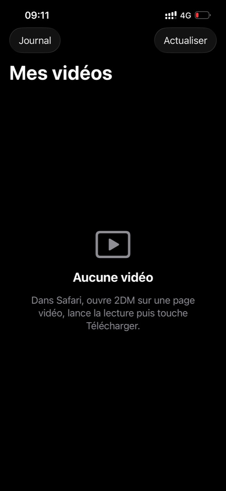
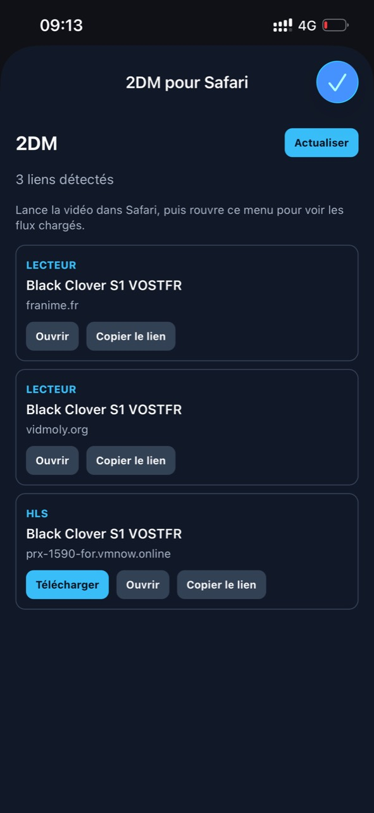
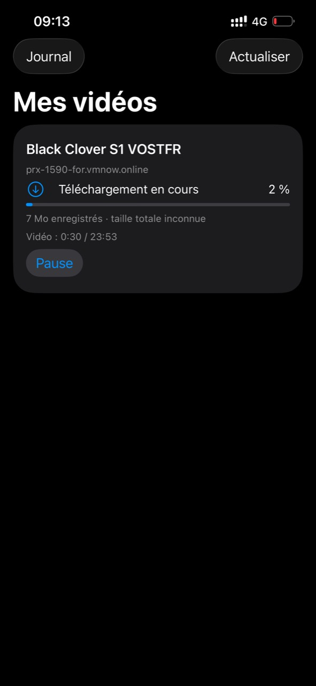

# 2DM pour SideStore et AltStore Classic

Ce dépôt public héberge les versions installables de 2DM et sa source AltStore. Le code de l'application reste dans un dépôt privé.

Ajouter cette source dans SideStore ou AltStore Classic :

https://raw.githubusercontent.com/ARIS-CODE-0/2DM-store/main/source.json

[Télécharger directement l’IPA 1.0.0](https://github.com/ARIS-CODE-0/2DM-store/releases/download/v1.0.0/2DM-SideStore.ipa?download=1)

L'application doit être signée par SideStore ou AltStore Classic avec le compte Apple de l'utilisateur avant son installation. Après installation, activer l'extension 2DM dans les réglages de Safari et l'autoriser sur les sites souhaités.

## Captures d’écran

